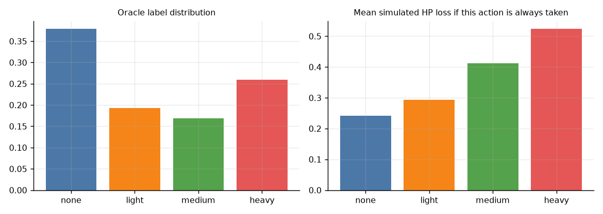
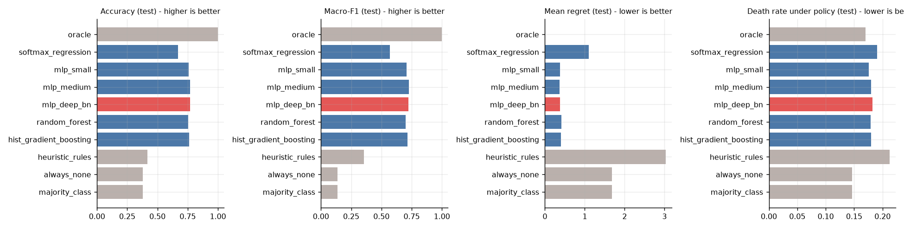
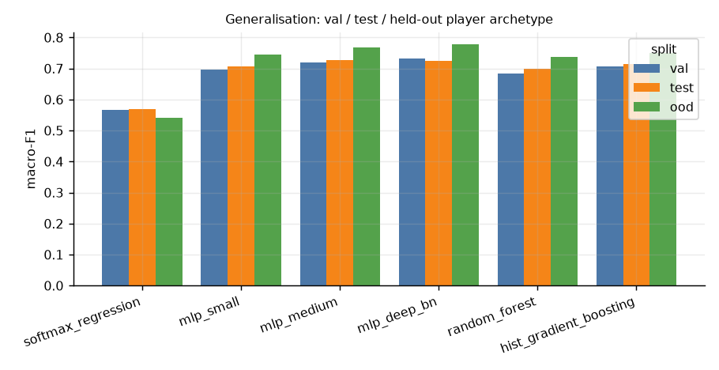
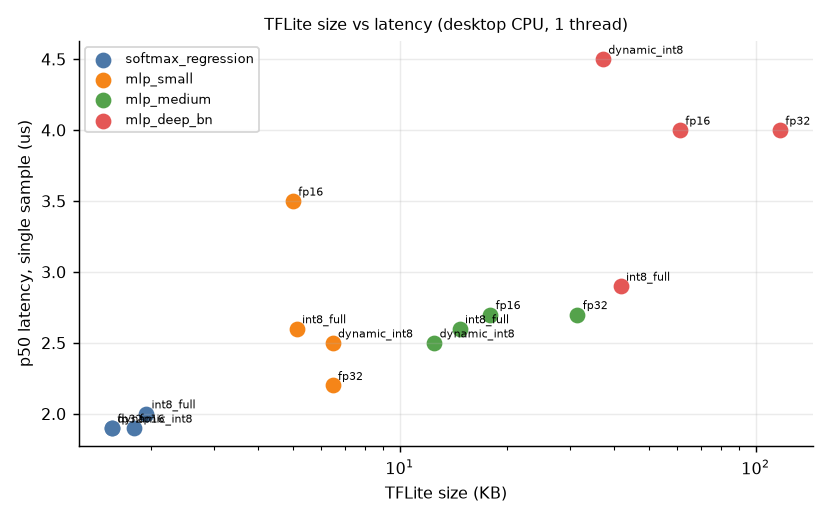
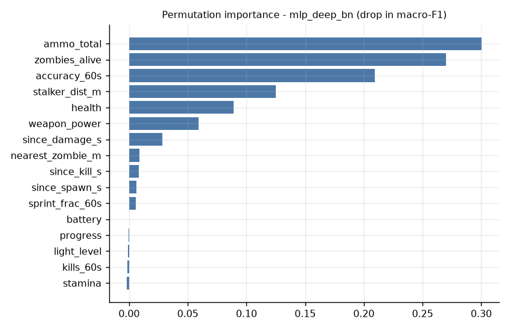

# Spawn-director models: evaluation report

_Generated 2026-11-04 16:52 - TensorFlow 2.20.0, scikit-learn 1.9.1, Python 3.12.16, seed 42._

## What the models do

Given 16 numbers describing the player's current situation (health, ammo, recent kills/damage, zombies alive, ...), predict how many zombies the director should spawn: **none / light (1) / medium (3) / heavy (5)**. The label for each training state is the action with the best simulated outcome, see *How labels were made*.

## How labels were made (and what that means for these numbers)

There is no real-player data yet. `ml/simulator.py` plays 16 randomised 40 s encounters for each of the four actions in each sampled state, using the game's real constants (zombie speed/damage, weapon stats, the 1.4 s invulnerability window). A designer-intent utility (aim for a target amount of health loss that grows when the player is bored and shrinks when they are fragile, punish death and running dry, respect the live-zombie cap) scores each action; the best one is the label. So every score below measures **how well a model reproduces that simulated oracle**, not how fun the game is. Held-out check: the `speedrunner` player archetype was never used for training.

Dataset: 48,000 states (70/15/15 train/val/test, stratified) + 6,000 held-out-archetype states. Label distribution: none 37.9%, light 19.3%, medium 16.9%, heavy 26.0%. 9.5% of labels have a margin under 0.1 utility between best and second-best action (near-ties, so some 'errors' are harmless).

## Headline results (test split)

| model | kind | params | test_accuracy | test_balanced_accuracy | test_macro_f1 | test_log_loss | test_roc_auc_macro_ovr | test_mean_regret | test_policy_death_rate |
|---|---|---|---|---|---|---|---|---|---|
| oracle | reference |  | 1.0000 | 1.0000 | 1.0000 |  |  | 0.0000 | 0.1700 |
| softmax_regression | keras | 68.0000 | 0.6719 | 0.5840 | 0.5695 | 0.8018 | 0.8634 | 1.0952 | 0.1902 |
| mlp_small | keras | 1140.0000 | 0.7593 | 0.7039 | 0.7070 | 0.5778 | 0.9246 | 0.3821 | 0.1756 |
| mlp_medium | keras | 7460.0000 | 0.7700 | 0.7239 | 0.7263 | 0.5467 | 0.9320 | 0.3725 | 0.1799 |
| mlp_deep_bn | keras | 30436.0000 | 0.7699 | 0.7235 | 0.7248 | 0.5406 | 0.9329 | 0.3764 | 0.1820 |
| random_forest | sklearn |  | 0.7553 | 0.6954 | 0.6990 | 0.6326 | 0.9192 | 0.4185 | 0.1792 |
| hist_gradient_boosting | sklearn |  | 0.7615 | 0.7132 | 0.7145 | 0.5757 | 0.9240 | 0.4030 | 0.1799 |
| heuristic_rules | reference |  | 0.4167 | 0.3621 | 0.3535 |  |  | 3.0339 | 0.2128 |
| always_none | reference |  | 0.3786 | 0.2500 | 0.1373 |  |  | 1.6850 | 0.1460 |
| majority_class | reference |  | 0.3786 | 0.2500 | 0.1373 |  |  | 1.6850 | 0.1460 |

*Mean regret* = average utility lost versus the oracle action (0 is perfect). *Death rate under policy* = simulated chance of dying if the model's action is taken. The hand-written rule baseline and the trivial baselines are included to show what the ML buys.

## Generalisation to an unseen player archetype

| model | val_macro_f1 | test_macro_f1 | ood_macro_f1 | ood_accuracy | ood_mean_regret | ood_policy_death_rate |
|---|---|---|---|---|---|---|
| softmax_regression | 0.5672 | 0.5695 | 0.5401 | 0.6775 | 1.8507 | 0.2980 |
| mlp_small | 0.6963 | 0.7070 | 0.7454 | 0.8072 | 0.3551 | 0.2668 |
| mlp_medium | 0.7191 | 0.7263 | 0.7668 | 0.8180 | 0.3422 | 0.2718 |
| mlp_deep_bn | 0.7319 | 0.7248 | 0.7782 | 0.8245 | 0.3701 | 0.2777 |
| random_forest | 0.6829 | 0.6990 | 0.7363 | 0.8010 | 0.4574 | 0.2780 |
| hist_gradient_boosting | 0.7056 | 0.7145 | 0.7489 | 0.8080 | 0.4644 | 0.2811 |

## 5-fold cross-validation (train+val pool)

| model | accuracy_mean | accuracy_std | macro_f1_mean | macro_f1_std | mean_regret_mean | mean_regret_std |
|---|---|---|---|---|---|---|
| hist_gradient_boosting | 0.7609 | 0.0042 | 0.7122 | 0.0051 | 0.4192 | 0.0099 |
| mlp_deep_bn | 0.7744 | 0.0057 | 0.7310 | 0.0064 | 0.3741 | 0.0251 |
| mlp_medium | 0.7664 | 0.0034 | 0.7217 | 0.0028 | 0.3913 | 0.0210 |
| mlp_small | 0.7531 | 0.0068 | 0.7044 | 0.0111 | 0.4457 | 0.0390 |
| random_forest | 0.7537 | 0.0032 | 0.6973 | 0.0019 | 0.4436 | 0.0140 |
| softmax_regression | 0.6655 | 0.0063 | 0.5656 | 0.0123 | 1.0588 | 0.0795 |

## TFLite variants (phone deployment)

| model | variant | size_kb | test_accuracy | test_macro_f1 | test_mean_regret | max_abs_prob_diff_vs_keras | argmax_agreement_vs_keras | latency_p50_us | latency_p99_us |
|---|---|---|---|---|---|---|---|---|---|
| softmax_regression | fp32 | 1.5547 | 0.6719 | 0.5695 | 1.0952 | 0.0000 | 1.0000 | 1.9000 | 3.9010 |
| softmax_regression | fp16 | 1.7930 | 0.6724 | 0.5710 | 1.0942 | 0.0016 | 0.9978 | 1.9000 | 2.3000 |
| softmax_regression | dynamic_int8 | 1.5547 | 0.6719 | 0.5695 | 1.0952 | 0.0000 | 1.0000 | 1.9000 | 4.2010 |
| softmax_regression | int8_full | 1.9375 | 0.6701 | 0.5654 | 1.0515 | 0.0269 | 0.9747 | 2.0000 | 3.9000 |
| mlp_small | fp32 | 6.4766 | 0.7593 | 0.7070 | 0.3821 | 0.0000 | 1.0000 | 2.2000 | 4.5000 |
| mlp_small | fp16 | 5.0078 | 0.7594 | 0.7070 | 0.3817 | 0.0040 | 0.9989 | 3.5000 | 6.2000 |
| mlp_small | dynamic_int8 | 6.4766 | 0.7593 | 0.7070 | 0.3821 | 0.0000 | 1.0000 | 2.5000 | 4.4000 |
| mlp_small | int8_full | 5.1328 | 0.7588 | 0.7046 | 0.3842 | 0.0881 | 0.9704 | 2.6000 | 5.2000 |
| mlp_medium | fp32 | 31.5586 | 0.7700 | 0.7263 | 0.3725 | 0.0000 | 1.0000 | 2.7000 | 2.9000 |
| mlp_medium | fp16 | 17.9570 | 0.7701 | 0.7265 | 0.3715 | 0.0027 | 0.9999 | 2.7000 | 5.1000 |
| mlp_medium | dynamic_int8 | 12.5000 | 0.7714 | 0.7280 | 0.3620 | 0.0965 | 0.9901 | 2.5000 | 2.7000 |
| mlp_medium | int8_full | 14.7266 | 0.7699 | 0.7255 | 0.3634 | 0.1174 | 0.9783 | 2.6000 | 4.5010 |
| mlp_deep_bn | fp32 | 117.0273 | 0.7699 | 0.7248 | 0.3764 | 0.0000 | 1.0000 | 4.0000 | 6.9020 |
| mlp_deep_bn | fp16 | 61.2617 | 0.7699 | 0.7248 | 0.3764 | 0.0032 | 1.0000 | 4.0000 | 5.9010 |
| mlp_deep_bn | dynamic_int8 | 37.2266 | 0.7700 | 0.7247 | 0.3753 | 0.0880 | 0.9910 | 4.5000 | 5.6000 |
| mlp_deep_bn | int8_full | 41.7500 | 0.7712 | 0.7259 | 0.3715 | 0.0965 | 0.9851 | 2.9000 | 4.6000 |

Latency is measured on this desktop CPU with one thread; phone CPUs are slower, but every model here is a few KB and a few thousand MACs, so expect tens of microseconds to well under a millisecond. Each decision happens roughly every 5 s.

## Per-class results of the deployed model (test)

| class | precision | recall | f1 | support |
|---|---|---|---|---|
| none | 0.8471 | 0.8885 | 0.8673 | 2726 |
| light | 0.6577 | 0.5259 | 0.5845 | 1388 |
| medium | 0.6052 | 0.5753 | 0.5899 | 1215 |
| heavy | 0.8150 | 0.9043 | 0.8574 | 1871 |

Per-model confusion matrices, ROC curves, calibration plots, training curves and classification reports are in `models/<name>/`.

## What drives the decision

Top features for the deployed model: `ammo_total` (0.300), `zombies_alive` (0.270), `accuracy_60s` (0.209), `stalker_dist_m` (0.125), `health` (0.089).

## Deployed model: `mlp_deep_bn`

Chosen because it has the lowest validation regret among the TFLite-convertible models. Artifacts: `ml/export/director.tflite` (fp32), `director_fp16.tflite`, `director_model.json` (copied to `src/game/ai/`), `parity_vectors.json`.

## Caveats

- Labels are simulator-derived; retrain on logged real play (the game keeps a director log, see `debugApi().directorLog()`) before trusting balance.
- The player bot in the simulator is simple (stand and fight, shoot the nearest target); real players kite, hide and use doors.
- Near-tie labels cap achievable accuracy, which is why regret and death-rate are reported next to accuracy.
